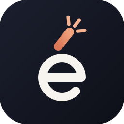
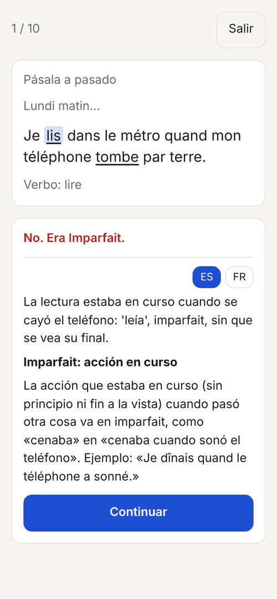
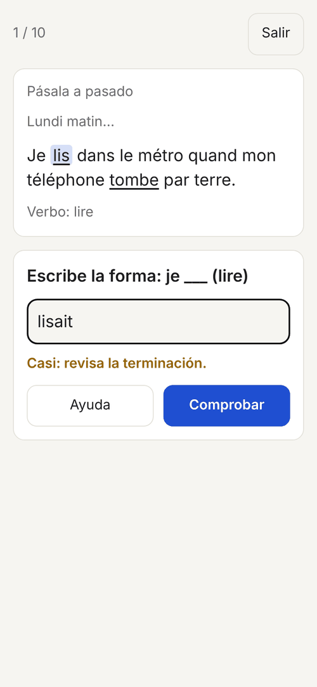
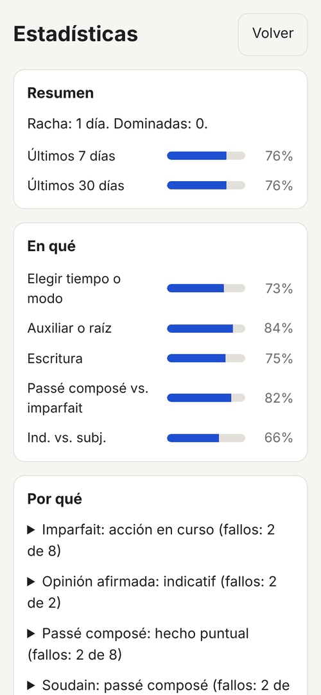

<div align="center">



# Déclic

**Choose the tense, not just the form.**

An offline Android app to practise the French choices that decide a written exam: passé composé versus
imparfait, and indicatif versus subjonctif. Built for daily practice and for the TEF Canada written
section.

[](LICENSE)


[](https://github.com/JoseJimenez-M/declic/actions/workflows/ci.yml)

</div>

---

## Why this exists

Most conjugation drills ask for a form in isolation: "aller, nous, imparfait". Real writing never asks
that. It asks you to choose: which past tense the context requires, and whether the clause in front of
the verb triggers the subjonctif. Those choices are exactly what the TEF Canada written section
measures: Section A continues a news item in the narrative past, and Section B argues an opinion,
which is where the subjonctif lives.

No free Android app combines the choice, an explanation of why it was wrong, typing with a closeness
check, and statistics of what keeps going wrong. Déclic does, and costs nothing to run: every sentence
and explanation is written once and shipped inside the app.

---

## What it does

- **Two exercise types.** *Put it in the past*: a sentence in the présent with one or two verbs marked,
  each one taken to passé composé or imparfait. *Which mood?*: a blank and an infinitive, filled in the
  indicatif or the subjonctif.
- **Three steps per verb.** Choose the tense or mood; then the auxiliary (passé composé: avoir or être)
  or the stem (subjonctif: regular or irregular); then type the form.
- **Explains every wrong choice**, specific to the sentence for the tense or mood and as the general
  rule for the auxiliary or stem, with an **ES | FR** toggle. The Spanish version uses Spanish as a
  bridge and flags where it misleads ("espero que vengas" is subjuntivo, "j'espère que tu viendras" is
  indicatif).
- **Grades typed answers** as exact, near or far, with at most two attempts. A near miss says what to
  check (accent, participle agreement, auxiliary, ending, stem, spelling). **Help** reveals the answer
  and the rule on any step.
- **Spaced review** with five Leitner boxes (back after 1, 3, 7, 14 and 30 days). A daily session of 10
  sentences puts due items first, then new ones, and alternates the two exercise types. An optional
  filter narrows it to the past tenses or to the moods.
- **Statistics of what, why and when**: accuracy per step and per pair, the rules and verbs failed
  most, the kinds of writing errors, and accuracy by time of day, weekday and week.
- **Export and backup**: a Markdown summary of the stats plus a full JSON backup through the Android
  share sheet; the JSON restores everything after a reinstall or on a new phone.
- **Report sentence**: flags an item that looks wrong; reports travel in the export.

The bank holds 350 sentences (200 past, 150 mood), about half everyday Montreal French and half TEF
style, each tied to one of 29 rules. UI labels are in Spanish; exercise content is French.

---

## Requirements

- An Android phone running Android 7.0 or newer.
- To develop: Node.js 22 and npm. No Java or Android SDK is needed on your machine: GitHub Actions
  builds and signs the APK.

---

## Install

> [!NOTE]
> The first release is not published yet. Until then there is no APK to download.

Once a release is out, download `declic-vX.Y.Z.apk` from
[Releases](https://github.com/JoseJimenez-M/declic/releases) on the phone and open it (allow installs
from the browser once). Updates install over the previous version and keep your data.

---

## First run

Open the app and tap **Empezar** for today's 10 sentences. Pick **Tema** first to practise only the
past tenses or only the moods. In **Ajustes**, choose the language of the explanations and export or
restore a backup. **Estadísticas** fills in as you practise.

---

## How it fits together

| Module | What it does |
|--------|--------------|
| `src/content/` | The sentence bank and rules (JSON), their types, the validator and the loader. |
| `src/checker.ts` | Normalises a typed answer and classifies it as exact, near (with a category) or far. |
| `src/flow.ts` | The exercise state machine: steps, attempts, Help, and the outcome of each item. |
| `src/srs.ts` | Leitner box transitions and due dates. |
| `src/session.ts`, `src/daily.ts` | Builds the daily 10 and tracks when a day counts as complete. |
| `src/stats.ts` | The aggregations behind the stats screen. |
| `src/export.ts` | Builds the Markdown summary and the JSON backup, and reads a backup back. |
| `src/dates.ts` | Local date helpers. |
| `src/storage.ts` | IndexedDB: attempts, boxes, reports and settings. |
| `src/share.ts` | The Capacitor Share and Filesystem adapter. |
| `src/ui/` | The screens: Home, Exercise, Stats and Settings. |

Everything except `storage`, `share` and `ui/` is a pure module; all of them except `share` and `ui/`
have Vitest tests. The web bundle is
packaged as an Android app with Capacitor, with the INTERNET permission removed.

---

## Screenshots

<div align="center">





**Left to right:** a wrong choice and its explanation, a near miss on the typed form, the stats screen.

</div>

---

## Things worth knowing

- **Your data stays on the phone.** The app has no INTERNET permission, so it cannot send anything
  anywhere. The release workflow fails if a build ever requests it.
- **Export before you uninstall.** Android backups are disabled, so uninstalling deletes the progress
  unless a JSON backup was exported first.
- **Only a clean answer moves an item up.** Every step right on the first try, without Help, sends it
  to the next box. A near miss fixed on the second attempt keeps it in its box; anything else sends it
  back to box 1. The stats count first tries only, and Help counts as a miss.
- **The streak counts a day once 10 sentences are done** (or nothing is left to practise that day).
- **A sentence marked wrong for a right answer is a bug.** Items where both tenses or both moods are
  defensible are dropped from the bank; if one slipped through, use **Reportar frase**.

---

## Development

```bash
npm install
npm run dev        # the app in a desktop browser; check flows at phone size
npm run typecheck
npm test           # Vitest unit tests, plus the content test over the whole bank
npm run build
```

The content test fails the build if any item lacks accepted answers, a valid rule, or either
explanation language. CI runs the typecheck, the tests and the build on every push to `main` and on
pull requests.

## Releasing

A `v*` tag builds, signs and publishes the APK. The one-time signing key and the tagging rules are in
[docs/releasing.md](docs/releasing.md).

---

## Bugs and contributions

Bug reports and wrong sentences are welcome as issues:
<https://github.com/JoseJimenez-M/declic/issues>. Outside pull requests are not accepted in v1.

## License

Source-available under PolyForm Noncommercial 1.0.0. Commercial use requires a license: contact
jimenez331375@gmail.com.

Personal, study, research, hobby, and noncommercial organizational use is permitted. Commercial use
(companies, paid services, resale, including modified versions) requires a separate license. This is
not an OSI open source license. The sentence bank is covered by the same license. See
[LICENSE](LICENSE).

Required Notice: Copyright 2026 Jose Jimenez (https://github.com/JoseJimenez-M)
